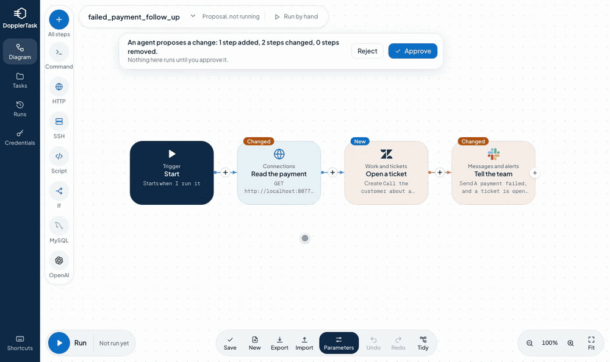
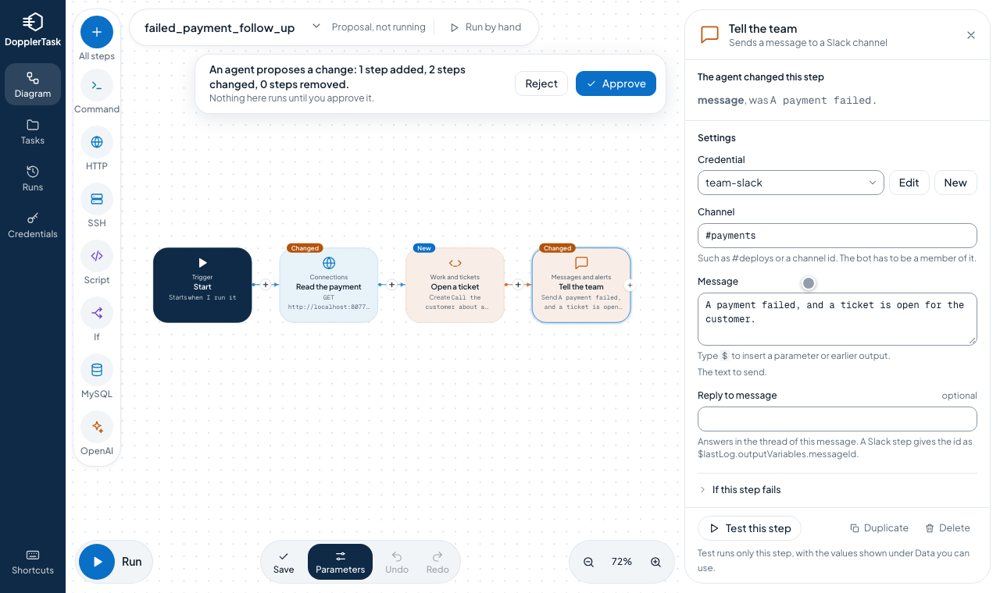
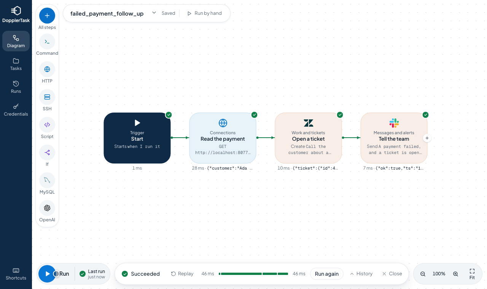
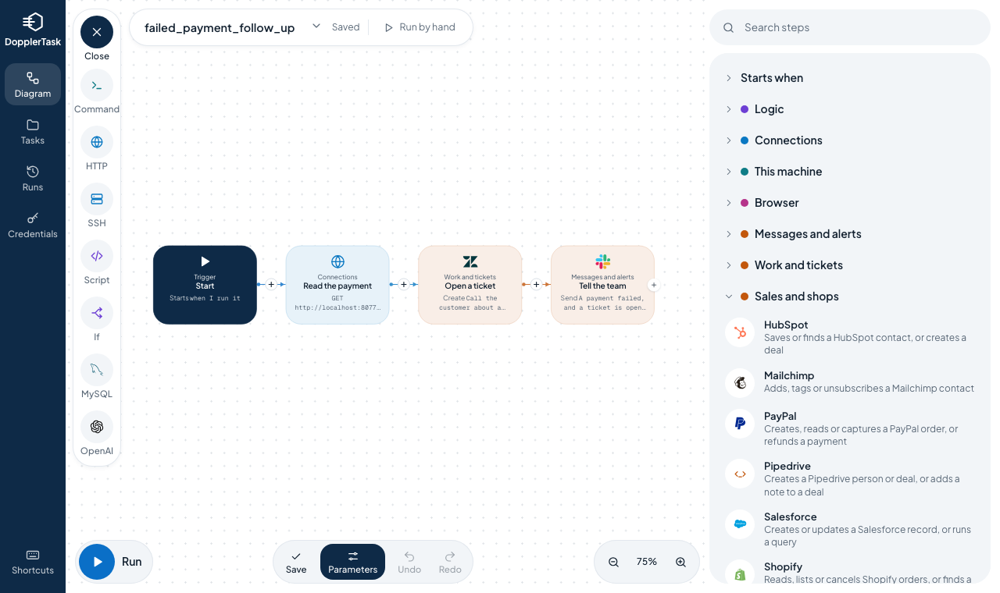

<div align="center">


<h1>Let AI agents build your automations.<br>You decide what goes live.</h1>

<p><strong>DopplerTask is the open-source control layer for AI agents.</strong><br>
Agents draft and change workflows, people approve them, and every run is on record, on your own servers.</p>

[](https://github.com/dopplertask/dopplertask/actions/workflows/test.yml)
[](LICENSE)
[](#81-steps-ready-to-use)
[](#connect-your-agent)

[Start in a minute](#start-in-a-minute) · [Connect your agent](#connect-your-agent) · [What you can build](#what-you-can-build) · [All steps](docs/actions.md)

<br>



<sub>An agent proposes a change. You see exactly what changed, approve it and run it.</sub>

</div>

## Why DopplerTask

<table>
<tr>
<td width="50%" valign="top">

### 🤖 Agents do the building
Describe the result you want. Your agent picks from 81 steps and builds the workflow, so you skip the wiring.

</td>
<td width="50%" valign="top">

### ✅ You stay in charge
Each change waits for your approval, with the changed steps marked and the old values beside the new. The approved version keeps running until you say yes.

</td>
</tr>
<tr>
<td width="50%" valign="top">

### 🔎 Every run is on record
See the output of each step, who started a run and who approved the change. Pick up a failed run from the step that failed.

</td>
<td width="50%" valign="top">

### 🔐 Secrets stay yours
Agents use your credentials by name, and the values stay encrypted on your server, out of the agent's reach.

</td>
</tr>
<tr>
<td width="50%" valign="top">

### 🏠 Runs where you do
One server on your own machine, with your data beside it. Sign in through your company's identity provider if you like.

</td>
<td width="50%" valign="top">

### 🧩 By hand or by agent
People and agents work on the same tasks in the same visual editor, so either one can pick up where the other stopped.

</td>
</tr>
</table>

## Start in a minute

On macOS or Linux, paste this in a terminal. Java comes with it, so you need nothing else:

```bash
curl -fsSL https://raw.githubusercontent.com/dopplertask/dopplertask/main/install.sh | sh
```

DopplerTask opens at **http://localhost:8090**. Choose *try an example you can run right away*. Run the same line again to update.

On Windows or a server, use Docker. Your tasks are kept in the volume `dopplertask`:

```bash
docker run -d --name dopplertask -p 8090:8090 -v dopplertask:/root dopplertask/dopplertask
```

To build from source, you need JDK 25:

```bash
git clone https://github.com/dopplertask/dopplertask.git
cd dopplertask/backend
./gradlew bootRun
```

## Connect your agent

DopplerTask speaks the [Model Context Protocol](https://modelcontextprotocol.io), so any agent that does can use it, with no setup. For Claude Code:

```bash
claude mcp add --transport http dopplertask http://localhost:8090/mcp
```

Other agents connect to `http://localhost:8090/mcp`. Then ask for what you need:

> *When a payment fails, open a Zendesk ticket for the customer and tell #payments on Slack.*

The agent looks up the steps, builds the task and proposes it. It appears in your editor, ready for you to approve or reject. Once approved, the agent can run it and read the results.

## What you can build

| When this happens | Your task does this |
| --- | --- |
| 💳 A payment fails | Reads it from **Stripe**, opens a **Zendesk** ticket and tells the team on **Slack** |
| 🚨 An alert fires | Asks **Prometheus** what is down, marks it on **Grafana** and pages the right person with **PagerDuty** |
| 🚀 A pipeline finishes | Starts the next one in **CircleCI**, checks **Sentry** for new issues and purges the **Cloudflare** cache |
| 👋 Someone leaves the company | Deactivates them in **Okta**, opens a **Jira** ticket and posts in **Microsoft Teams** |
| 📬 Every five minutes | Reads new email, has **Claude** summarise it, opens a **Freshdesk** ticket and adds a row in **Airtable** |
| 🛒 An order comes in | Reads it from **Shopify**, sends it to **Kafka** and adds a row in **Google Sheets** |

A task can start from a webhook, on a schedule, from a message queue, by hand or from your agent.

## 80 steps, ready to use

| Group | Steps |
| --- | --- |
| **Messages and alerts** | Discord, Email, Mattermost, Microsoft Teams, Outlook, PagerDuty, Read email, SendGrid, Slack, SMS (Twilio), Telegram, WhatsApp |
| **Work and tickets** | Asana, Bitbucket, CircleCI, ClickUp, Freshdesk, Gitea, GitHub, GitLab, Intercom, Jira, Linear, monday.com, Trello, Zendesk |
| **Sales and shops** | HubSpot, Mailchimp, PayPal, Pipedrive, Salesforce, Shopify, Stripe, WooCommerce |
| **Operations and servers** | Cloudflare, Datadog, DigitalOcean, Grafana, Okta, Prometheus, Sentry |
| **Documents and tables** | Airtable, Box, Confluence, Google Calendar, Google Drive, Google Sheets, Notion, OneDrive, S3, Supabase, WordPress |
| **Connections** | Elasticsearch, HTTP request, Kafka, MongoDB, MQTT, MySQL, Postgres, RabbitMQ, Redis, SCP, SSH |
| **AI** | Claude, OpenAI |
| **This machine and browser** | Run command, Read file, Write file, Browse the web, Use the mouse |
| **Logic** | Convert XML, Extract with regex, If, Print message, Run another task, Script, Set variable, Switch, Wait |
| **Also** | Jenkins |

Anything with an API is one **HTTP request** step away. Tried a step with your own account and found something to improve? [Tell us](https://github.com/dopplertask/dopplertask/issues), it helps everyone. Every step and its fields are in the [step reference](docs/actions.md).

## See it

<table>
<tr>
<td width="50%"></td>
<td width="50%"></td>
</tr>
<tr>
<td align="center"><strong>Review what the agent changed</strong></td>
<td align="center"><strong>Follow every run, step by step</strong></td>
</tr>
</table>



## Ready for real work

- **Reliable runs.** Retries, continue on failure, restarting from the failed step and a `/health` address for your monitoring.
- **Protected access.** Separate tokens for people and agents, and single sign-on with any OpenID Connect provider.
- **Encrypted credentials.** AES-256-GCM, with a task that you can share freely since it only holds the name of a credential.
- **Made for teams.** Versions of every task, export and import, a command line tool and a full REST API.

Read [Running DopplerTask](docs/operations.md) before you put it in front of others, since a server that runs commands deserves a token.

## Or use the API

Save a task and run it:

```bash
curl -X POST localhost:8090/task -H 'Content-Type: application/json' -d '{
  "name": "hello", "active": false,
  "actions": [
    {"@type": "StartAction",
     "ports": [{"externalId": "start", "portType": "OUTPUT"}]},
    {"@type": "PrintAction", "message": "Hello from DopplerTask",
     "ports": [{"externalId": "print", "portType": "INPUT"}]}
  ],
  "connections": [{"source": {"externalId": "start"}, "target": {"externalId": "print"}}]
}'

curl -X POST localhost:8090/schedule/directtask -H 'Content-Type: application/json' \
  -d '{"taskName": "hello", "parameters": {}}'
```

## Learn more

- 📘 **[Steps](docs/actions.md):** every step, its fields, retries, webhooks and variables
- 🛠️ **[Build a task through the API](docs/task.md):** the format of a task, with examples
- 🚀 **[Running DopplerTask](docs/operations.md):** Docker, running around the clock, credentials, upgrading and security
- 🧑‍💻 **[Development](docs/development.md):** work on DopplerTask itself

## Contribute

A new step is one file and one line where steps are registered, which makes it a great first pull request. See [Development](docs/development.md), open an [issue](https://github.com/dopplertask/dopplertask/issues), or send a pull request.

## License

[MIT](LICENSE). Made by [Feras Wilson](https://github.com/feraswilson) and contributors.

Logos of other services belong to their owners, and only show which service a step connects to. See [where they come from](docs/development.md#logos).
