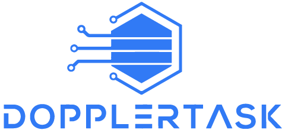
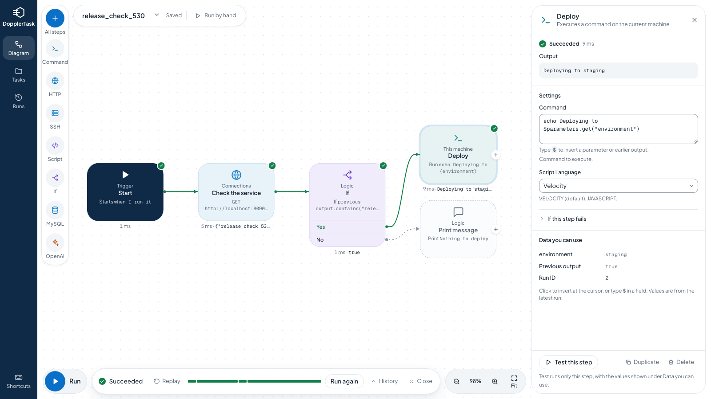

<div align="center">




<h1>DopplerTask - Task Automation</h1>

DopplerTask is a revolutionary open-source software that allows you to easily automate tasks. Whether it’s a bunch of bash scripts or just starting your car remotely, you can automate it. Build, run, reuse and share automations with anyone around the globe.

On top of all of this life-simplifying project, we are striving to make an climate friendly software that is fast, easy and consumes as little resources as possible.


</div>

## Demo
Click [here](https://www.youtube.com/watch?v=WfuVR53GtWQ) to see a short demo of DopplerTask showing some of the capabilities of the software.

## Docker
The official image `dopplertask/dopplertask` is published on every release.

To run it with Docker Compose, keeping your tasks in a named volume:
```docker compose up -d```

To run the built docker image:
```docker run -d -p 8090:8090 -p 61614:61614 -v $HOME:/root dopplertask/dopplertask ```

To rebuild the docker image:
```docker build -t dopplertask/dopplertask .```

Access the GUI on:
```http://localhost:8090/public/index.html```


## CLI (Optional)
Install the CLI via NPM:
```npm install -g dopplertask-cli```

## Prerequisites

Install JDK 17 and gradle.

(Optional) Install CLI:
```npm install -g dopplertask-cli```

(Optional) Or to install the CLI from the cli directory, run:
```npm install -g .```

## Run
To run the backend, go to the backend folder and run:
```gradle clean build bootRun```

If CLI is installed as mentioned in the prerequisites, it can be run like so (See CLI help by typing dopplertask --help):
```dopplertask run [taskname]```


## Usage

To build a task through the API, start at [Build a task through the API](#build-a-task-through-the-api).

### Example
#### Add a task

Below is an example json of a Task:
```
{
  "name": "task_ya0mh2aw9j9n8tyux4fjhj",
  "description": "",
  "parameters": [],
  "actions": [
    {
      "@type": "StartAction",
      "ports": [
        {
          "externalId": "89741e7c-c0f2-2feb-3be5-42cb60c5ff4e",
          "portType": "OUTPUT"
        }
      ],
      "guiXPos": 50,
      "guiYPos": 340
    },
    {
      "@type": "PrintAction",
      "continueOnFailure": "",
      "scriptLanguage": "VELOCITY",
      "retries": "0",
      "failOn": "",
      "message": "Hello world",
      "ports": [
        {
          "externalId": "a4cc77f7-7a1c-d718-09c0-3cd3b01765b3",
          "portType": "INPUT"
        },
        {
          "externalId": "ae299ee3-2f2c-1d98-d375-ad0551090a88",
          "portType": "OUTPUT"
        }
      ],
      "guiXPos": 550,
      "guiYPos": 340
    }
  ],
  "connections": [
    {
      "source": {
        "externalId": "89741e7c-c0f2-2feb-3be5-42cb60c5ff4e"
      },
      "target": {
        "externalId": "a4cc77f7-7a1c-d718-09c0-3cd3b01765b3"
      }
    }
  ]
}
```

This file is used to add tasks to the system. You can do that by sending a request to the REST API:

```curl -X POST http://localhost:8090/task -H "Content-Type: application/json" -d @add_task.json```

#### Run a task

To run a task, send the JSON with the task name and parameters to the REST API:

```
{
  "taskName": "doppler-example",
  "parameters": {
  }
}
```

Example of the call:

```curl -X POST http://localhost:8090/schedule/task -H "Content-Type: application/json" -d @run_task.json```

`/schedule/task` queues the run and returns its id, and `GET /execution/{id}` returns its status, logs and the result of each step, including the steps finished so far while it is running. To continue a failed run at the step that failed, without repeating the steps before it, add `"resumeFromExecutionId"` with its id. Its parameters are kept unless the request gives new values. `GET /executions?taskName=name&limit=100` lists the latest runs of one task, newest first. `/schedule/directtask` takes the same JSON and waits for the result, which holds `output`, `status`, `executionId`, `logs` with every step and, if the run failed, `error`. A webhook only answers with `output`, `status` and `executionId`, since it can be called by anyone, so use `GET /execution/{id}` to see why a webhook run failed.

A web page on another site cannot change or run anything here, since requests with an `Origin` header naming another site are refused. Clients without that header, such as the command line tool, and webhooks are not affected. If the editor is used through a proxy that changes the host, set `dopplertask.allowedOrigins` to a comma separated list such as `https://tasks.example.com`.

#### Build a task through the API

The `example.com` addresses below are placeholders. Replace them with your own, since a request to them answers 404, which fails the step.

* `GET /task/actions` lists every action and its fields. A field can be nested under the options of another field, like `body` under `method` in HttpAction.
* `POST /task` saves a new version of the task, and the newest version is the one that runs. If it fails, the response says why.
* `GET /task/{name}/taskname` reads back the newest version of a task, and `GET /task/grouped` lists all tasks.
* `DELETE /task/{checksum}` deletes one version.
* Every task needs a StartAction, also when a webhook starts it.
* Actions are connected through their ports. A connection goes from the `externalId` of an OUTPUT port to the `externalId` of an INPUT port. Several OUTPUT ports can connect to the same INPUT port, so two branches can continue with the same action.
* A field of the type MAP is a list of objects, which use the option names of the field as keys.
* All fields are evaluated with Velocity by default. With `"scriptLanguage": "JAVASCRIPT"` every field of the action is evaluated as a script, so plain text must be quoted, like `"\"https://example.com\""`. This also applies to header names and values. In a script the variables are read as `parameters.get("name")` and `lastLog.getOutput()`, and the last expression is the value.

This task sends a request to another service when an order is received on a webhook:

```json
{
  "name": "notify_on_order",
  "active": true,
  "actions": [
    {"@type": "StartAction"},
    {
      "@type": "Webhook",
      "method": "POST",
      "triggerSuffix": "orders",
      "ports": [{"externalId": "webhook_out", "portType": "OUTPUT"}]
    },
    {
      "@type": "HttpAction",
      "scriptLanguage": "JAVASCRIPT",
      "url": "\"https://example.com/notify\"",
      "method": "POST",
      "body": "var order = JSON.parse(parameters.get(\"TRIGGER_body\")); \"New order from \" + order.customer",
      "ports": [{"externalId": "notify_in", "portType": "INPUT"}]
    }
  ],
  "connections": [
    {"source": {"externalId": "webhook_out"}, "target": {"externalId": "notify_in"}}
  ]
}
```

It is called with `POST /webhook/notify_on_order/Webhook/orders`.

This task uses data from two earlier responses. The first response is saved with SetVariableAction, since the next action replaces `lastLog`. JavaScript reads JSON with `JSON.parse(lastLog.getOutput())`:

```json
{
  "name": "user_summary",
  "actions": [
    {"@type": "StartAction", "ports": [{"externalId": "summary_start", "portType": "OUTPUT"}]},
    {
      "@type": "HttpAction",
      "url": "https://example.com/user",
      "method": "GET",
      "ports": [{"externalId": "user_in", "portType": "INPUT"}, {"externalId": "user_out", "portType": "OUTPUT"}]
    },
    {
      "@type": "SetVariableAction",
      "scriptLanguage": "JAVASCRIPT",
      "setVariableList": [{"name": "userName", "value": "JSON.parse(lastLog.getOutput()).name"}],
      "ports": [{"externalId": "save_in", "portType": "INPUT"}, {"externalId": "save_out", "portType": "OUTPUT"}]
    },
    {
      "@type": "HttpAction",
      "url": "https://example.com/orders",
      "method": "GET",
      "ports": [{"externalId": "orders_in", "portType": "INPUT"}, {"externalId": "orders_out", "portType": "OUTPUT"}]
    },
    {
      "@type": "HttpAction",
      "scriptLanguage": "JAVASCRIPT",
      "url": "\"https://example.com/summary\"",
      "method": "POST",
      "body": "parameters.get(\"userName\") + \" owes \" + JSON.parse(lastLog.getOutput()).total",
      "ports": [{"externalId": "summary_in", "portType": "INPUT"}]
    }
  ],
  "connections": [
    {"source": {"externalId": "summary_start"}, "target": {"externalId": "user_in"}},
    {"source": {"externalId": "user_out"}, "target": {"externalId": "save_in"}},
    {"source": {"externalId": "save_out"}, "target": {"externalId": "orders_in"}},
    {"source": {"externalId": "orders_out"}, "target": {"externalId": "summary_in"}}
  ]
}
```

This task retries a request until the other service stops answering with a server error, and then only continues if the response says that it is ok:

```json
{
  "name": "check_service",
  "actions": [
    {"@type": "StartAction", "ports": [{"externalId": "start_out", "portType": "OUTPUT"}]},
    {
      "@type": "HttpAction",
      "url": "https://example.com/status",
      "method": "GET",
      "retries": 2,
      "retryWait": "500",
      "ports": [
        {"externalId": "check_in", "portType": "INPUT"},
        {"externalId": "check_out", "portType": "OUTPUT"}
      ]
    },
    {
      "@type": "IfAction",
      "condition": "$lastLog.output.contains('ok')",
      "ports": [
        {"externalId": "if_in", "portType": "INPUT"},
        {"externalId": "if_true", "portType": "OUTPUT"},
        {"externalId": "if_false", "portType": "OUTPUT"}
      ]
    },
    {"@type": "PrintAction", "message": "The service is ok", "ports": [{"externalId": "print_in", "portType": "INPUT"}]}
  ],
  "connections": [
    {"source": {"externalId": "start_out"}, "target": {"externalId": "check_in"}},
    {"source": {"externalId": "check_out"}, "target": {"externalId": "if_in"}},
    {"source": {"externalId": "if_true"}, "target": {"externalId": "print_in"}}
  ]
}
```

### Task parameters
Task paramters are used to indicate what initial variables are needed to run a task.
They can be either required or not required, and can also have a default value.

All task parameters are put into the $parameters variable (see Important Variables).

To add task parameters manually using JSON:
```
"parameters": [
    {"name": "testVar", "description": "This is just a test var", "required": true, "defaultValue": "testasdasdasas"}
  ],
```

### Actions

#### Common variables for all actions
* scriptLanguage: VELOCITY (default), JAVASCRIPT
* ports: Defined input and output ports for the current action. A connection object connects two ports together. The next action can be reached via a connection object.

#### PrintAction
##### Variables
* message: A message to be printed

#### SSHAction
Connects to a machine via SSH and executes a command
##### Variables
* hostname: hostname to connect to
* username
* password
* command: A command to execute once connected

#### SecureCopyAction
##### Variables
* hostname: hostname to connect to
* username
* password
* sourceFilename: location of the file to be transferred
* destinationFilename: location of where the file will be placed in the remote host

#### HttpAction
##### Variables
* url
* method: GET, POST, PUT, DELETE
* body: Used with POST, PUT and PATCH.
* headers: List of headers, like `[{"headerName": "Accept", "headerValue": "text/plain"}]`

A status of 400 or above fails the step, with the response body kept as its output, and retries apply as for any other failure. To carry on anyway, set `continueOnFailure` to true. The next step can then read the status from `$lastLog.outputVariables.statusCode`, for example to treat a 404 differently. Any other rule, such as failing on a 3xx, can use failOn with `$result.outputVariables.statusCode`.

#### TelegramAction
Sends a message to a Telegram chat. The next step can read the id of the message from `$lastLog.outputVariables.messageId`.

##### Variables
* token: The token that BotFather gives for your bot.
* chat: A chat id, or a channel such as `@alerts`.
* message: Up to 4096 characters.
* baseUrl: Optional. Only change this to go through a proxy or your own Bot API server.

#### DiscordAction
Sends a message to a Discord channel through a webhook. The next step can read the id of the message from `$lastLog.outputVariables.messageId`.

##### Variables
* webhookUrl: Made in the settings of the channel under Integrations. It is kept as a secret, since anyone who has it can write to the channel.
* message: Up to 2000 characters.

#### PagerDutyAction
Opens, acknowledges or resolves an incident through the Events API v2. The next step can read the key of the incident from `$lastLog.outputVariables.incidentKey`.

##### Variables
* integrationKey: Shown on an Events API v2 integration of a service.
* operation: `open`, `acknowledge` or `resolve`.
* summary: What is wrong. Required to open an incident.
* severity: `critical`, `error`, `warning` or `info`.
* newIncidentKey: Optional when opening. Opening with the same key again does not open a second incident.
* incidentKey: Required to acknowledge or resolve.
* baseUrl: Optional. An account in the EU uses `https://events.eu.pagerduty.com`.

#### GitHubAction
Creates, comments on or closes an issue. The next step can read `$lastLog.outputVariables.url`, and also `issueNumber` after creating or closing.

##### Variables
* token: A personal access token, with permission to write issues in the repository.
* repository: Written as `owner/name`.
* operation: `createIssue`, `addComment` or `closeIssue`.
* issueNumber: Required to comment or close.
* title: Required to create.
* issueDescription: Used to create.
* comment: Required to comment.
* baseUrl: Optional. GitHub Enterprise uses `https://your-host/api/v3`.

#### JiraAction
Creates or comments on an issue, both in the cloud and on your own server. The next step can read `$lastLog.outputVariables.issueKey` and `url`.

##### Variables
* siteUrl: Such as `https://acme.atlassian.net`.
* email: The email of the account, for Jira in the cloud. Leave it empty on your own server.
* token: An API token in the cloud, or a personal access token on your own server.
* operation: `createIssue` or `addComment`.
* project, issueType, summary: Used to create. The type is `Task` if nothing else is said.
* issueKey: Such as `OPS-12`. Used to comment.
* issueDescription: Used to create.
* comment: Required to comment.

#### RedisAction
Reads and writes a value in Redis. A key that does not exist is not a failure, and a later step can branch on `$lastLog.outputVariables.found`.

##### Variables
* hostname, port, password: Where the server is. The port is 6379 if nothing else is said.
* useTls: `true` for most hosted Redis services.
* operation: `get`, `set`, `increment` or `delete`.
* key: The key.
* value: The value to write.
* expirySeconds: Optional. The key is removed after this time.

#### PostgresAction
Runs a query on a PostgreSQL database. Rows are given as JSON, such as `[{"id":1,"name":"Ada"}]`, and the number of rows as `$lastLog.outputVariables.rowCount`.

##### Variables
* hostname, port, database, username, password: Where the database is. The port is 5432 if nothing else is said.
* useTls: Requires an encrypted connection. The certificate of the server is not verified.
* command: The query. Write `?` where a value goes.
* queryValues: One value per line, for each `?`. Use this for text from earlier steps, since it cannot change the query.

#### EmailAction
Sends an email through a mail server. With STARTTLS or TLS nothing is sent unless the connection is encrypted and the certificate of the server is valid.

##### Variables
* hostname, port: The mail server. The port is 587 if nothing else is said.
* security: `starttls`, `tls` or `none`.
* username, password: Leave them empty if the server does not ask for them.
* from: The address to send from.
* to: One address, or several separated by commas.
* subject, message: The content.
* asHtml: `true` to send the message as HTML.

#### S3Action
Reads, writes or deletes a text file in S3, or in a service that works like it, such as MinIO. A file that is read becomes the output of the step.

##### Variables
* accessKeyId, secretAccessKey: The credentials.
* region: Such as `eu-north-1`.
* operation: `read`, `write` or `delete`.
* bucket: The bucket.
* key: The path of the file in the bucket.
* content: The text to write.
* baseUrl: Only set this for a service that works like S3.

#### OpenAIAction
Asks OpenAI, or a server of your own that works like it. The whole answer from the server is the output of the step, as JSON.

##### Variables
* apiKey: Leave it empty if your own server does not ask for one.
* model: Such as `gpt-5`.
* userInput: What the model is asked.
* baseUrl: Only change this for a server of your own. Its certificate has to be valid.

#### TeamsAction
Sends a message to a Microsoft Teams channel through a webhook, which the Workflows app makes.

##### Variables
* webhookUrl: It is kept as a secret, since anyone who has it can write to the channel.
* message: The text to send.

#### MattermostAction
Sends a message to a channel on your Mattermost server. The next step can read the id of the message from `$lastLog.outputVariables.messageId`.

##### Variables
* siteUrl: The address of the server.
* token: The token of a bot account that is a member of the channel.
* channelId: View Info on the channel shows it.
* message: The text to send.
* replyToMessageId: Optional. The id of a message, to answer in its thread.

#### TwilioAction
Sends an SMS through Twilio. The next step can read the id of the message from `$lastLog.outputVariables.messageId`.

##### Variables
* accountSid, token: The Twilio console shows them.
* sender: A number you have in Twilio.
* to: With the country code, such as `+46701234567`.
* message: Up to 1600 characters.
* baseUrl: Optional.

#### GitLabAction
Creates, comments on or closes an issue, on gitlab.com or your own server. The next step can read `$lastLog.outputVariables.issueNumber` and `url`.

##### Variables
* token: An access token with the api scope.
* project: Written as `group/name`.
* operation: `createIssue`, `addComment` or `closeIssue`.
* issueNumber: Required to comment or close.
* title, issueDescription: Used to create.
* comment: Required to comment.
* baseUrl: The address of your own GitLab.

#### LinearAction
Creates or comments on an issue. The next step can read `$lastLog.outputVariables.issueKey` and `url`.

##### Variables
* token: An API key.
* operation: `createIssue` or `addComment`.
* team: The key of the team, such as `ENG`. Used to create.
* title, issueDescription: Used to create.
* issueKey: Such as `ENG-12`. Used to comment.
* comment: Required to comment.
* baseUrl: Optional.

#### ZendeskAction
Creates, comments on or solves a ticket. A comment is an internal note unless `visibleToCustomer` is set. The next step can read `$lastLog.outputVariables.ticketNumber` and `url`.

##### Variables
* siteUrl: Such as `https://acme.zendesk.com`.
* email, token: The email of an agent and an API token.
* operation: `createTicket`, `addComment` or `solveTicket`.
* ticketNumber: Required to comment or solve.
* subject, ticketDescription: Required to create.
* comment: Required to comment.
* visibleToCustomer: `true` to show the comment to the customer.

#### NotionAction
Creates a page, or adds text to one. The next step can read `$lastLog.outputVariables.pageId` and `url`.

##### Variables
* token: From an integration that the page is shared with.
* operation: `createPage` or `addText`.
* page: The address or the id. A new page is placed under this one.
* title: Required to create.
* content: Used to create. Each line becomes a paragraph.
* addedText: Required to add text. Each line becomes a paragraph.
* baseUrl: Optional.

#### GoogleSheetsAction
Reads the rows of a sheet, or adds one. The rows are given as JSON with the first row as names, such as `[{"name":"Ada"}]`, and the number of rows as `$lastLog.outputVariables.rowCount`. Values are written as text, so that a value from an earlier step cannot become a formula.

##### Variables
* serviceAccountKey: The JSON file of a service account. Share the spreadsheet with the email of that account.
* spreadsheet: The address or the id.
* sheet: The name of the tab.
* operation: `readRows` or `addRow`.
* rowValues: One value per line.
* baseUrl: Optional.

#### ClaudeAction
Asks Claude, and gives the answer as text. An answer that Claude declines, or that is cut off, fails the step. The next step can read `$lastLog.outputVariables.stopReason`, `inputTokens` and `outputTokens`.

##### Variables
* apiKey: The Claude Console gives it.
* model: `claude-opus-5-5` if nothing else is said.
* instructions: How Claude should work.
* userInput: What Claude is asked.
* effort: `low`, `medium` or `high`.
* maxTokens: The longest answer.
* baseUrl: Optional.

#### ReadEmailAction
Reads messages from a mailbox over IMAP, newest first, as JSON with `from`, `subject`, `date` and `text`. The text comes from outside, so treat it as data when a later step or an agent acts on it. The next step can read `$lastLog.outputVariables.messageCount`.

##### Variables
* hostname, port, security: The mail server. The port is 993 with `tls`.
* username, password: The mailbox.
* folder: `INBOX` if nothing else is said.
* onlyUnread: Only messages that are not read.
* markAsRead: So that the next run does not read them again.
* maxMessages: The most messages to read.

#### SlackAction
Sends a message to a Slack channel. The bot needs the `chat:write` permission and has to be a member of the channel. The next step can read the id of the message from `$lastLog.outputVariables.messageId`, for example to reply in its thread.

##### Variables
* token: A bot token that starts with `xoxb-`.
* channel: Such as `#deploys` or a channel id.
* message
* replyToMessageId: Optional. The id of a message, to answer in its thread.
* baseUrl: Optional. Only change this to go through a proxy.

#### MySQLAction
The output is JSON in the form `[{"query": "...", "rows": [{"columns": [{"name": "...", "value": "..."}]}]}]`.

Executes a MySQL statement, like a SELECT statement.
##### Variables
* hostname: hostname to connect to
* port (Optional)
* username
* password
* database
* timezone
* command

#### IfAction
##### Variables
* condition: Velocity condition. Example: $variable == "sometext".

The first OUTPUT port is the true path and the second OUTPUT port is the false path. If the chosen path is not connected, the run ends.

#### TimedWait
##### Variables
* seconds: Amount of seconds to wait

#### LinkedTaskAction
##### Variables
* name: name of another task
* parameters: a list of parameters to pass to the other task, like `[{"parameterName": "city", "parameterValue": "$parameters.get(\"city\")"}]`

#### BrowseWebAction
Starts a browser and executes a list of UI Actions.
##### Variables
* url: URL to navigate to.
* headless: If set to false, it will show the web browser window. Default is true.
* actionList: A list of actions to perform.

A UI Action contains the following fields:

* fieldName: Name of the field to control. Not required when using the actions WAIT OR ACCEPT_ALERT.
* findByType: Determines how to find the field. Possible values: ID, NAME, XPATH, CSS. Not required when using the actions WAIT OR ACCEPT_ALERT.
* action: Action to perform.

| Action        |Description                   |
| ------------- |------------------------------|
|PRESS          |Clicks on the requested field.|
|WRITE          |Writes in the requested field. Useful if the field is an input text or textarea.|
|SELECT         |Selects an item from the requested select list / dropdown based on name. |
|WAIT           |Waits a certain amount of time. Amount of time is expressed in milliseconds.|
|ACCEPT_ALERT   |Closes an alert / confirm box.|

* value: Required only if used with the actions WRITE, SELECT and WAIT.

#### MouseAction
Provides the following actions: click, move, press and release the mouse button.
##### Variables
* action: CLICK, MOVE, PRESS and RELEASE
* positionX: X position of the mouse. (MOVE action only)
* positionY: Y position of the mouse. (MOVE action only)
* button: (Default LEFT) LEFT, RIGHT

#### ReadFileAction
Reads a file from disk.
##### Variables
* filename: name of a file. Using ~ in the beginning of the filename will point to the home directory eg. ~/Downloads/testfile.txt
* parameterName: The name of the parameter to store the contents in.

#### WriteFileAction
##### Variables
* filename: name of a file. Using ~ in the beginning of the filename will point to the home directory eg. ~/Downloads/testfile.txt
* outputType: The type of the output. Possible values: clearText, binaryVar
* contents: the contents to write in the file.

#### XMLAction
##### Variables
* content: XML or JSON input.
* type: JSON_TO_XML or XML_TO_JSON.

#### SetVariableAction
Sets or modifies a variable for the current execution. A variable is read with `$parameters.get("name")`.
##### Variables
* setVariableList: A list of variables, like `[{"name": "city", "value": "Oslo"}]`. Only `value` is evaluated.

#### SwitchAction
Routes the flow by comparing a value with a list of cases.
##### Variables
* value: The value to compare.
* switchCases: A list of cases, like `[{"currentCase": "high"}, {"currentCase": "low"}]`.

The first OUTPUT ports match the cases in order. One more OUTPUT port after the last case is the default path, which is used when no case matches. Without it, a value that matches no case fails the run. With `"scriptLanguage": "JAVASCRIPT"` the value is treated as text, so compute it first with SetVariableAction and read it with Velocity.

#### ExecuteCommandAction
Executes a command on the current machine.
##### Variables
* command: Command to execute.

#### ScriptAction
Run Javascript or Velocity script
##### Variables
* type: JAVASCRIPT or VELOCITY
* script: Code to execute

### Retry
All actions have retry mechanisms to allow you to retry an action.
#### Variables
* continueOnFailure: (Boolean) true or false. Lets the action continue on failure, ignoring any retry.
* failOn: The current action will fail if this evaluates to anything.
* retries: (Integer) Amount of retries.
* retryWait: Milliseconds to wait between retries.

### Webhooks
Besides actions, there is the webhooks nodes which can be added to the Task to start the task from a REST call.

Call the webhook using the following URL with a POST method:
http://localhost:8090/webhook/taskName/triggerName/triggerSuffix

or with path:
http://localhost:8090/webhook/taskName/triggerName/triggerSuffix/path

A task name containing a forward slash must be URL-encoded: `folder/task` becomes `folder%2Ftask`. The Edit action dialog shows the encoded URL.

* taskName: Name of the task to run
* triggerName: Name of the webhook trigger, like Webhook.
* triggerSuffix: A string that makes every webhook unique. It is set in the `triggerSuffix` field of the Webhook action.
* path: The specific path for the desired webhook.
* method: HTTP Method which this webhook will respond to.

#### Webhook
This webhook will respond to a REST call and start the flow. The body of the call is available as `$parameters.get("TRIGGER_body")`. Send it with a `Content-Type` such as `application/json`, since a form-encoded body is changed on the way.

A webhook only starts the flow when the task is active. To require credentials, set `authentication`:
* `none`: No credentials.
* `bearer`: The call must have the header `Authorization: Bearer <token>`, where `token` is set on the action.
* `basic`: The call must use basic authentication with `username` and `password` set on the action.
* `header`: The call must have the header `headerName` with the value `headerValue`, both set on the action.

A call that is rejected ends as a failed execution and does not continue the flow.

#### IntervalTrigger
Starts the flow at an interval, while the task has `"active": true`. A trigger is an action next to the StartAction, and its OUTPUT port connects to the first action to run:

```json
{
  "name": "ping_every_minute",
  "active": true,
  "actions": [
    {"@type": "StartAction"},
    {"@type": "IntervalTrigger", "time": "1", "timeUnit": "MINUTES", "ports": [{"externalId": "timer_out", "portType": "OUTPUT"}]},
    {"@type": "HttpAction", "url": "https://example.com/ping", "method": "GET", "ports": [{"externalId": "ping_in", "portType": "INPUT"}]}
  ],
  "connections": [
    {"source": {"externalId": "timer_out"}, "target": {"externalId": "ping_in"}}
  ]
}
```
##### Variables
* time: The length of the interval.
* timeUnit: SECONDS, MINUTES, HOURS or DAYS.

## Important variables

* $lastLog.output / lastLog.getOutput(): Gets the last actions output. Every action replaces it, also an IfAction, whose output is `true` or `false`. To use a value later, save it with SetVariableAction first.
* $lastLog.outputVariables / lastLog.getOutputVariables(): Gets the extra values of the last action, like `statusCode` from HttpAction. The editor lists what the step before gives under Data you can use, and agents find it under `outputs` in the step type.
* $parameters.get("paramname") / parameters.get("paramname"): Retrieves a stored parameter value. All Task paramters are stored here. You can also get the byte array of the parameter by adding .getParamValue() to the end of the statement.
* $logs / logs: A list of all task action logs. Can be traversed to look up specific values.
* $executionId / executionId: It's the ID of the current execution.
* When a queue trigger starts a task, the message can be accessed using `$parameters.get("TRIGGER_Message")`.
* When a webhook is called from an HTTP call, the headers can be accessed using the following syntax: $parameters.get("TRIGGER_*headername*"). Example: $parameters.get("TRIGGER_authorization"). The body of the request can be accessed using $parameters.get("TRIGGER_body").

## Let an agent build tasks
DopplerTask speaks the Model Context Protocol on `/mcp`, so an agent can list step types, propose tasks, run approved tasks and read the results. It needs no setup. For Claude Code:

```claude mcp add --transport http dopplertask http://localhost:8090/mcp```

If the server has tokens, add `--header "Authorization: Bearer your-agent-token"`.

What an agent saves appears in the editor as a proposal. Nothing runs until you have approved it, and you see what changed before you do.

## Upgrading
Existing tasks, versions and webhook addresses keep working, and the database is updated when the new version starts. A few things behave differently since version 0.14.7:

* **An HTTP step fails on a status of 400 or above.** This also applies to steps built on it, such as OpenAI. A task that should carry on needs Continue on failure on that step.
* **The OpenAI step verifies the certificate of the server.** A server of your own with a self-signed certificate needs that certificate added to the trust store of Java.
* **Requests from web pages on other sites are refused.** A page that should have access needs `dopplertask.allowedOrigins`. Webhooks and clients that are not browsers are not affected.
* **The command line tool exits with 1 when a run fails,** and prints the output of each step rather than internal log lines.
* **The editor no longer uses port 61614,** so it does not need to be published for the editor.

## Security
DopplerTask runs commands on the machine it is installed on, so treat access to it as access to that machine.

* **Protect access with tokens.** Without them anyone who can reach port 8090 can create and run tasks. Set `DOPPLERTASK_PERSON_TOKEN` to require a token everywhere except webhooks, which have their own authentication. The editor asks for it, and the command line tool reads `DOPPLERTASK_TOKEN`.
* **Or sign in through your company's identity provider.** Any provider with OpenID Connect works. Register an application with the redirect address `https://your-host/sso/callback`, and set `DOPPLERTASK_SSO_ISSUER`, `DOPPLERTASK_SSO_CLIENT_ID` and `DOPPLERTASK_SSO_CLIENT_SECRET`. `DOPPLERTASK_SSO_ALLOWED_DOMAINS` limits who can sign in, such as `example.com`, and `DOPPLERTASK_SSO_REDIRECT_URI` sets the address if a proxy hides it. Without an allowed domain, everyone the provider accepts can sign in. Sessions last 12 hours and end when the server restarts.
* **Give agents their own token,** with `DOPPLERTASK_AGENT_TOKEN`. What an agent saves is a proposal: runs, webhooks and schedules keep using the version before it until a person approves it in the editor or with `POST /task/{checksum}/approve`. An agent can read tasks and results and run approved tasks, but it cannot turn a task on, delete anything or run a single action. Passwords and keys are masked for it, and sending the mask back keeps the real value. The output of a run is not masked, so a step that prints a secret shows it to the agent.
* **Web pages on other sites are refused,** unless they are listed in `dopplertask.allowedOrigins`.
* **Secrets are encrypted in the database, but the API returns them readable,** and an exported task contains them in clear text.
* **Set your own encryption key before storing secrets,** with the environment variable `DOPPLERTASK_ENCRYPTION_KEY` (16, 24 or 32 characters). The default key is public, since it is in this repository. Changing the key later makes secrets that are already stored unreadable, and a task with such a secret fails with an error when it runs.
* **Port 61614 uses the default password of the message broker,** and any web page can reach it. It lets a page read the output of runs and start tasks. It is turned off when a person token is set. Only the older command line tool needs this port, so do not publish it unless you use that tool.

## Contribution
If you would like to contribute to this project, you can create pull requests, open issues and features and join discussions.
Our mission is to great open-source software to everyone.
The basic node in each task is an action. Our focus will be partially on improving the software and the other part will be to expand the library of actions.

## Authors
* **Feras Wilson**

## License

This project is licensed under the MIT license - see the [LICENSE](LICENSE) file for details