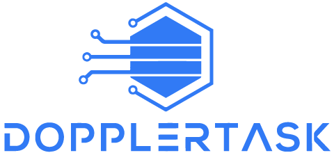
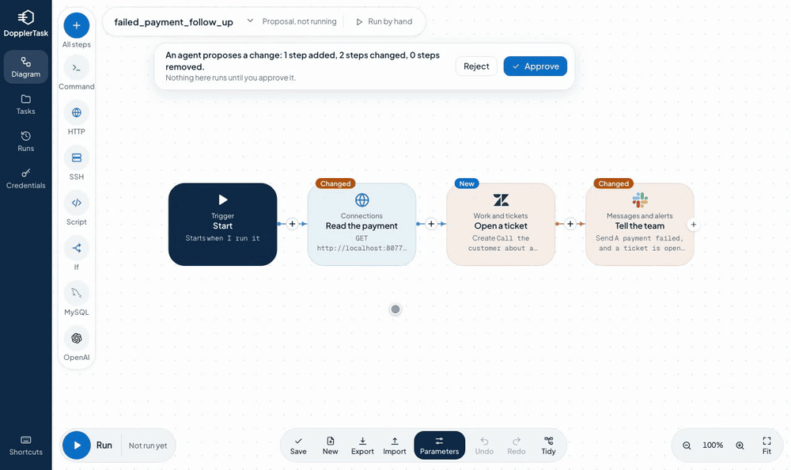

<h1>Let AI agents build your automations. You decide what goes live.</h1>

Start with the [quick start](quick-start.md), or read about the [steps](actions.md) and [running DopplerTask](operations.md).
